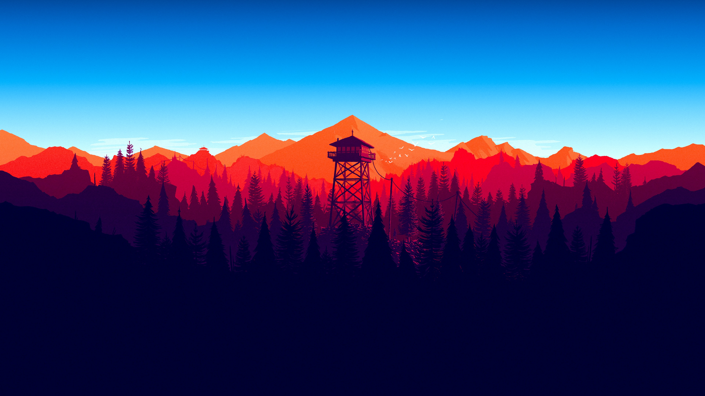
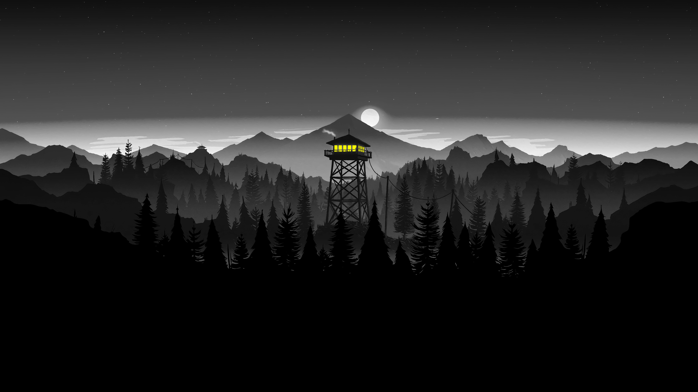
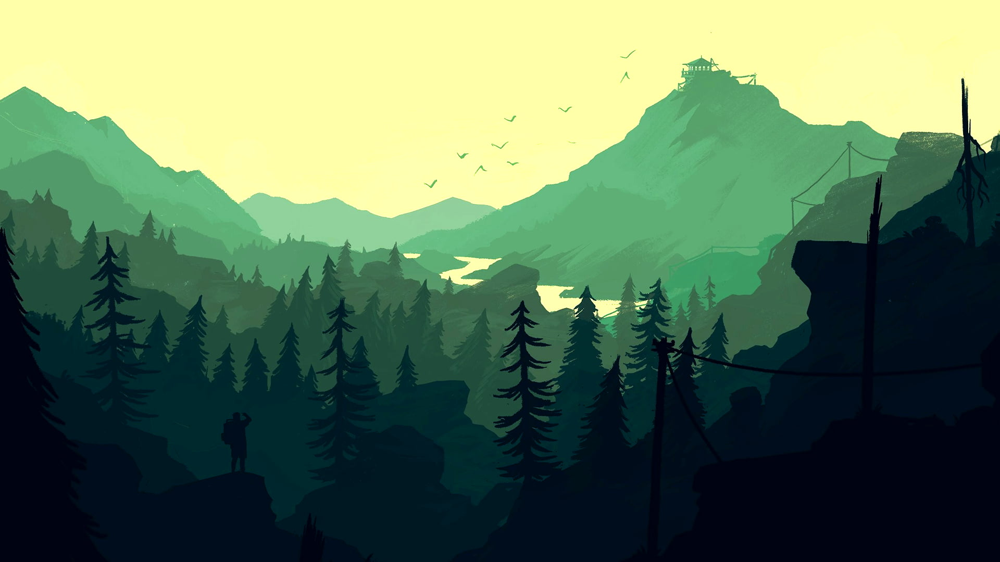

<p align="center">
  
</p>

<h1 align="center">Firewatch Dashboard</h1>

<p align="center">
  A quiet, fan-made focus dashboard inspired by Firewatch.<br />
  Clock, Pomodoro, stopwatch, Ranger Log, and the original soundtrack in one calm screen.
</p>

<p align="center">
  <a href="https://firewatch-outpost.vercel.app/"><strong>Live Link</strong></a>
  ·
  <a href="https://github.com/Cosmosynth/Firewatch-Clock-Trials/issues">Report an issue</a>
  ·
  <a href="https://github.com/Cosmosynth/Firewatch-Clock-Trials">Source code</a>
</p>

<p align="center">
  
  
  
</p>

---

## About

Firewatch Dashboard is a single-page workspace built for deep work. It stays out of the way: a large clock, a small set of tools, and a background that changes with your mood. Everything runs in the browser with no build step and no framework.

This is an unofficial tribute. It is not affiliated with Campo Santo or Valve, and it is not a commercial product.

## Features

| Area | What it does |
| --- | --- |
| **Clock** | Live time, full date, 12/24-hour format, three preset positions, and free dragging with double-click reset. |
| **Pomodoro** | Timestamp-based focus and break sessions that stay accurate in background tabs. Custom lengths, four-session cycle, long breaks, and an optional chime. |
| **Stopwatch** | Millisecond precision with lap history. |
| **Home status** | Running Pomodoro and stopwatch times stay visible above the toolbar. |
| **Ranger Log** | A persistent checklist for the day. Add, complete, delete, and clear finished tasks. Nothing resets automatically. |
| **Music** | The Firewatch OST with track list, shuffle, repeat, seek, and volume. A separate Lofi Radio mode streams third-party stations over HTTPS. |
| **Themes** | Fifteen Firewatch-inspired backgrounds, from sunset to pencil sketch. |
| **Persistence** | Theme, clock position, format, volume, timer state, music mode, and the Ranger Log survive a reload. |
| **Accessibility** | Keyboard shortcuts, visible focus rings, dialog focus trapping, reduced-motion support, and real buttons for the clock format toggle. |

## Themes

<p align="center">
  
  
  
</p>

## Getting started

There is nothing to install and nothing to build.

```bash
git clone https://github.com/Cosmosynth/Firewatch-Clock-Trials.git
cd Firewatch-Clock-Trials
```

Open `index.html` directly, or run a small local server so audio and metadata behave consistently:

```bash
python -m http.server 8000
```

Then visit `http://localhost:8000`.

Any static host works. The live site is deployed on Vercel.

## Keyboard shortcuts

| Key | Action |
| --- | --- |
| `T` | Cycle the theme |
| `M` | Cycle the clock position |
| `P` | Open or close the Pomodoro |
| `S` | Open or close the stopwatch |
| `O` | Open or close the music player |
| `R` | Open or close the Ranger Log |
| `I` | Open the About dialog |
| `F` | Toggle fullscreen |
| `Space` | Play or pause the current audio |
| `Escape` | Close a panel or the About dialog |

Shortcuts are ignored while typing in a field and while a modifier key is held.

## Privacy and local data

There are no accounts and no server-side storage. Progress is saved in your browser with `localStorage`:

| Key | Contents |
| --- | --- |
| `fw.settings.v1` | Theme, clock position and coordinates, format, volume, Pomodoro settings, and music mode |
| `fw.pomodoro.v1` | Timer phase, session count, and the timestamp of the active session |
| `fw.rangerlog.v1` | Ranger Log tasks |

Clearing site data resets the dashboard. The welcome screen uses `sessionStorage` only to avoid showing itself twice in one session. The hosted deployment also uses Vercel's aggregate page-view analytics; it does not create accounts or store your checklist, timer, or audio settings.

## Project structure

```text
.
├── index.html        Markup, metadata, About dialog
├── style.css         Themes, layout, panels, responsive styles
├── script.js         Clock, timers, Ranger Log, audio, shortcuts
├── manifest.json     PWA metadata
├── vercel.json       Cache and security headers
├── icon/             App icons, including a maskable variant
├── wallpapers/       Theme backgrounds
└── ost/              Firewatch soundtrack files
```

## Browser support

Recent versions of Chrome, Edge, Firefox, and Safari. The dashboard uses modern JavaScript, Pointer Events, and the Web Audio API. If a radio stream is unavailable, the player reports it and can move to the next station; the OST is served locally.

## Attribution

- **Firewatch** and its artwork are the property of Campo Santo and Valve.
- **Firewatch Original Soundtrack** was composed and produced by **Chris Remo**. All rights remain with the composer and the rights holders.
- **"I'd Rather Go Blind"** is performed by **Etta James**, written by **Ellington Jordan** and **Billy Foster**. Rights remain with their respective holders.
- **Lofi and radio streams** belong to their providers, artists, and licensors. This project does not host those streams.

This project is a non-commercial fan tribute. It has no ads, no subscriptions, and generates no revenue. If you are a rights holder and would like something removed, please open an issue and it will be handled promptly.

## License

The source code in this repository is available under the [MIT License](LICENSE).

The license does not cover the Firewatch name, artwork, soundtrack, or any third-party audio streams. Those remain the property of their respective rights holders and are included here as part of a fan tribute.

## Credits

Built and maintained by [Hasya (u/Wizard_1512)](https://github.com/Cosmosynth).

Inspired by the visual design and atmosphere of Firewatch.
